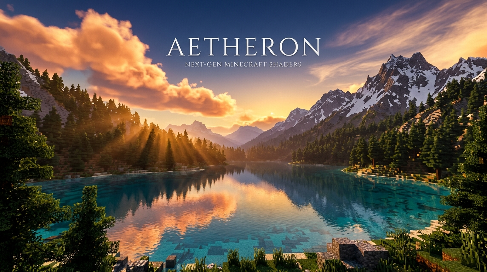
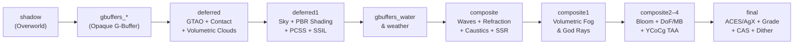

<div align="center">



<br />
<br />

# ✦ A E T H E R O N ✦

### *Next-Generation Minecraft Shader Pack — Cinematic Lighting meets Living Atmosphere*

*Uma arquitetura GLSL original inspirada na excelência visual de **Photon** e **Bliss**, projetada para entregar iluminação cinematográfica, nuvens volumétricas 3D, água fotorrealista e alta eficiência em GPUs modernas.*

<br />

[](modern/)
[](legacy_1.12.2/)
[](tools/validate_shaders.py)
[](performance_profiles/README.md)
[](LICENSE)

<br />

[✨ Recursos](#-destaques-visuais) •
[⚡ Perfis de Performance](#-perfis-de-performance--rtx-5070) •
[🏗️ Arquitetura](#️-arquitetura-do-pipeline) •
[📦 Instalação](#-instalação-rápida) •
[🔄 Modern vs Legacy](#-compatibilidade-modern-vs-legacy) •
[📚 Documentação](#-documentação-técnica)

</div>

---

## 🌌 Identidade Visual

**Aetheron** não é uma cópia nem um port genérico — é um pipeline gráfico construído do zero para unir o melhor de dois mundos:

<table>
<tr>
<td width="50%" valign="top">

### ☀️ Inspiração Cinematográfica *(Photon)*
- Iluminação solar fisicamente inspirada com contraste equilibrado e natural
- Sombras suaves com **PCSS de penumbra variável** (Ultra) e **Contact Shadows**
- Água cristalina com absorção espectral **Beer-Lambert**, cáusticas animadas e **SSR refinado por busca binária**
- Color grading natural com tonemapping **ACES / AgX / Aetheron Filmic** sem saturação artificial

</td>
<td width="50%" valign="top">

### ☁️ Atmosfera Viva *(Bliss)*
- Espalhamento atmosférico **Rayleigh + Mie dual-lobe + Ozônio (Chappuis)** com crepúsculos cobalto-dourados
- **Nuvens volumétricas 3D procedurais** (Perlin-Worley) com auto-sombreamento e camada superior de **Cirrus**
- Transições dinâmicas de clima, chuva com poças reflexivas e névoa de vale por altitude
- Iluminação adaptada por bioma (desertos, montanhas frias, pântanos/selvas e oceanos)

</td>
</tr>
</table>

---

## ✨ Destaques Visuais

| Sistema | Implementação Técnica |
| :--- | :--- |
| **🌅 Atmosfera & Céu** | Espalhamento Rayleigh + Mie dual-lobe + absorção de Ozônio; disco solar com *limb darkening*; Lua com fases reais (`moonPhase`), mares lunares e *earthshine*; campo estelar multi-camada cintilante + faixa da Via Láctea; céus dedicados para **Nether** e **The End** (nebulosa cósmica + vórtice). |
| **☁️ Nuvens Volumétricas** | **Ultra**: Raymarching 3D Perlin-Worley (28 passos adaptativos + 4 passos de auto-sombreamento solar + efeito Beer-Powder + Cirrus). **Medium**: Volumétrico otimizado (16 passos + 2 luz). **Low**: Camada analítica 2D ultraleve preservando pôr do sol e tempestades. |
| **💡 Iluminação & Sombras** | Shadow map distorcido (`1024`–`4096`), bias *normal-offset + slope-scale*, amostragem **Vogel Disk** PCF/PCSS, sombras coloridas em vitrais, **Foliage SSS**, **GTAO**, **SSIL** (iluminação indireta difusa), blocklight Planckiano configurável, luz dinâmica na mão, poças de chuva e iluminação natural de cavernas. |
| **🌊 Água & Reflexos** | Ondas multi-oitava (até 5 camadas), anéis de pingos de chuva animados, refração com proteção de profundidade, absorção Beer-Lambert, cáusticas subaquáticas, espuma costeira, Fresnel de Schlick e **SSR com busca binária** + fallback de céu/nuvens. |
| **🌫️ Névoa Volumétrica** | Raios crepusculares (*God Rays*) amostrados no shadow map com fase Henyey-Greenstein, névoa analítica de vale por altura, perspectiva atmosférica à distância e neblina subaquática realista. |
| **🌿 Vegetação Dinâmica** | Simulação de vento por vértice sincronizada entre terreno e shadow map (rajadas viajantes + intensificação na chuva) para grama, flores, folhas, plantações, vinhas e algas. |
| **🎞️ Pós-Processamento** | Bloom *Karis-weighted* em duas escalas (zero *fireflies*), Auto-Exposição adaptativa, 4 curvas de Tonemapping (**ACES**, **AgX Neutral**, **Aetheron Filmic**, **Uncharted 2**), **TAA** com *variance clamping* em YCoCg 3×3, **CAS Sharpening**, DoF Bokeh opcional, Motion Blur opcional, vinheta sutil e dithering triangular anti-banding. |

---

## ⚡ Perfis de Performance & RTX 5070

Projetado tendo como referência **NVIDIA GeForce RTX 5070 + AMD Ryzen 7 9800X3D**, com escalabilidade inteligente em 3 presets — **e liberdade total para customizar cada efeito individualmente nos 8 sub-menus**.

| Recurso | 🟢 `LOW` *(Performance)* | 🟡 `MEDIUM` *(Balanceado)* | 🟣 `ULTRA` *(RTX Next-Gen)* |
| :--- | :---: | :---: | :---: |
| **Resolução de Sombras** | `1024 × 1024` | `2048 × 2048` | `4096 × 4096` |
| **Distância de Sombras** | `128 blocos` | `192 blocos` | `256 blocos` |
| **Filtro de Sombras** | Vogel PCF (5 taps) | Vogel PCF (9 taps) + Vitrais | **PCSS Penumbra Variável** (6 + 14 taps) |
| **Contact Shadows** | Off | On | On |
| **Nuvens** | Analíticas 2D + Cirrus | Volumétricas 3D (16 steps) | **3D Perlin-Worley (28 steps + 4 sun)** |
| **Névoa Volumétrica / God Rays** | 7 steps | 12 steps + ruído 3D | **20 steps + ruído 3D** |
| **Água & Reflexos SSR** | 2 oitavas • SSR 12 steps | 3 oitavas • Refração • SSR 22 steps | **5 oitavas • Caustics • SSR 36 steps (5 bin)** |
| **Ambient Occlusion (GTAO)** | 4 taps | 8 taps | **12 taps multi-horizonte** |
| **Iluminação Indireta (SSIL)** | Off | 4 taps | **8 taps** |
| **TAA + CAS + Bloom** | Fast Bloom | YCoCg TAA + CAS + Dual Bloom | **YCoCg TAA + CAS + Dual Bloom** |
| **Tempo de Frame Est. (1440p • RTX 5070)** | **~2.6 ms (~380 FPS)** | **~5.2 ms (~190 FPS)** | **~9.2 ms (~108 FPS)** |

> Veja a análise completa por passo de GPU em [`performance_profiles/README.md`](performance_profiles/README.md) e [`shared_documentation/PERFORMANCE_AND_OPTIMIZATION.md`](shared_documentation/PERFORMANCE_AND_OPTIMIZATION.md).

---

## 🏗️ Arquitetura do Pipeline

Pipeline enxuto de **8 buffers (`colortex0`–`colortex7`)** com reuso inteligente de memória, empacotamento octaédrico de normais (`RG16F`), término antecipado em raymarching e descarte completo do shadow pass no Nether e no End:



---

## 📦 Instalação Rápida

Os arquivos `.zip` prontos para arrastar na pasta `shaderpacks/` do Minecraft estão disponíveis diretamente em [`dist/`](dist/):

<details open>
<summary><b>🟢 Modern Edition — Minecraft 1.20.x / 1.21.x+ (Iris + Sodium)</b></summary>

1. Instale **Iris Shaders + Sodium** na sua versão de Minecraft (`1.20.x` ou `1.21.x+`).
2. Baixe [`dist/Aetheron-Modern-Iris-1.20+.zip`](dist/Aetheron-Modern-Iris-1.20+.zip).
3. No jogo, acesse **Opções → Gráficos → Pacotes de Shaders → Abrir Pasta**.
4. Coloque o `.zip` na pasta `shaderpacks/`, selecione **Aetheron-Modern-Iris-1.20+** e clique em **Aplicar**.
5. Abra **Configurações do Shader** e escolha o perfil **Low**, **Medium** ou **Ultra**.

</details>

<details>
<summary><b>🟠 Legacy Edition — Minecraft 1.12.2 (OptiFine HD U G5+)</b></summary>

1. Instale o **OptiFine 1.12.2 HD U G5** (ou superior).
2. Baixe [`dist/Aetheron-Legacy-OptiFine-1.12.2.zip`](dist/Aetheron-Legacy-OptiFine-1.12.2.zip).
3. Desative **Fast Render** nas opções de desempenho do OptiFine.
4. Coloque o `.zip` na pasta `shaderpacks/` e selecione **Aetheron-Legacy-OptiFine-1.12.2**.
5. Deixe *Render Quality* e *Shadow Quality* em `1.0x` e ajuste a qualidade pelo menu interno de perfis.

</details>

---

## 🔄 Compatibilidade: Modern vs Legacy

Em vez de forçar código incompatível entre gerações separadas por 8 anos de motor gráfico, o Aetheron mantém **duas bases dedicadas** com a mesma alma visual:

| Aspecto Técnico | Modern (`modern/`) | Legacy (`legacy_1.12.2/`) |
| :--- | :--- | :--- |
| **Versão GLSL** | `#version 330 compatibility` | `#version 120` |
| **Saídas / Samplers** | `layout(location)` • `RENDERTARGETS` • `gtexture` | `gl_FragData[N]` • `DRAWBUFFERS` • `texture` |
| **IDs de Blocos** | Pós-Flattening (`short_grass`, `cherry_leaves`, `sculk_sensor`, `copper_bulb`, `soul_lantern`) | Pré-Flattening (`tallgrass`, `double_plant`, `leaves2`, `flowing_water`, `lit_redstone_lamp`) |
| **Dimensões** | `dimension.properties` (`*` modded fallback) + `world0`/`world-1`/`world1` | `world0/` (Overworld), `world-1/` (Nether), `world1/` (End) |
| **Uniformes de Bioma/Clima** | `biome_category`, `thunderStrength`, `darknessFactor`, `entity.properties` | `biome` (IDs 1.12.2), tempestade derivada de `rainStrength`/`wetness` |

---

## 🧪 Validação Automatizada & Build

Cada alteração passa pelo validador automatizado com **Khronos `glslangValidator`**, testando **todas as dimensões** (`world0`, `world-1`, `world1`) × **5 matrizes de configuração** (`LOW`, `MEDIUM`, `ULTRA`, `ULTRA + AgX/DoF/MB`, `Minimal Toggles`) em ambas as edições:

```bash
# Compila e valida todos os 1.480 shaders (Modern GLSL 330 + Legacy GLSL 120)
python3 tools/validate_shaders.py --edition all

# Empacota os arquivos .zip prontos para o Minecraft em dist/
python3 tools/package_releases.py
```

```text
=== Validating Modern-Iris-1.20+ (148 shader entrypoints x 5 configs) ===
  Config LOW / MEDIUM / ULTRA / EXTRAS / MINIMAL : PASS (740/740)

=== Validating Legacy-OptiFine-1.12.2 (148 shader entrypoints x 5 configs) ===
  Config LOW / MEDIUM / ULTRA / EXTRAS / MINIMAL : PASS (740/740)

=== SUMMARY: 1480/1480 shader compilations succeeded ===
```

---

## 📁 Estrutura do Repositório

```text
Aetheron/
├── assets/                   # Identidade visual e banner do projeto
├── modern/                   # Edição Moderna — Iris + Sodium (MC 1.20.x–1.21.x+)
├── legacy_1.12.2/            # Edição Legada — OptiFine (MC 1.12.2 / GLSL 120)
├── performance_profiles/     # Presets Low / Medium / Ultra & orçamento de GPU
├── shared_documentation/     # Documentação técnica completa do pipeline
├── tools/                    # Validador GLSL (glslangValidator) e empacotador .zip
└── dist/                     # Pacotes .zip prontos para instalação no Minecraft
```

---

## 📚 Documentação Técnica

- 📐 **[Arquitetura & Matemática do Pipeline](shared_documentation/ARCHITECTURE.md)**
- 🔄 **[Matriz de Compatibilidade Modern vs Legacy](shared_documentation/COMPATIBILITY.md)**
- 🛠️ **[Guia Completo de Instalação e Vídeo](shared_documentation/INSTALLATION.md)**
- 🎛️ **[Guia de Configuração e Menus (65 Opções)](shared_documentation/CONFIGURATION.md)**
- 🚀 **[Otimização de GPU & Profiling (RTX 5070)](shared_documentation/PERFORMANCE_AND_OPTIMIZATION.md)**
- ✅ **[Testes, Validação GLSL & Checklist QA](shared_documentation/TESTING_AND_QA.md)**

---

<div align="center">

Feito com precisão em GLSL • Licenciado sob **[MIT License](LICENSE)**

⭐ *Se curtir o Aetheron, deixe uma estrela no repositório!* ⭐

</div>
