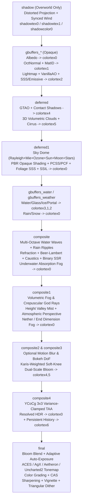

# Aetheron Shaders — Technical Rendering Architecture

**Aetheron** is an original deferred + translucent-composite Minecraft shader architecture synthesizing **Photon's** cinematic lighting, shadow precision, and water clarity with **Bliss's** expansive atmospheric scattering, volumetric cloudscapes, and organic environmental mood.

---

## 1. End-to-End Frame Pipeline

---

## 2. Compact 8-Buffer G-Buffer & Attachment Layout

Both **Modern (Iris 1.20+)** and **Legacy (OptiFine 1.12.2)** share an optimized 8-buffer layout (`colortex0`–`colortex7`) that minimizes VRAM footprint and memory bandwidth while fitting strictly within OptiFine 1.12.2's 8-attachment hardware ceiling:

| Buffer | Format | Clear | Opaque Stage | Deferred / Translucent Stage | Post-Processing Stage |
| :--- | :--- | :---: | :--- | :--- | :--- |
| `colortex0` | `RGBA16F` | Yes | Albedo `.rgb`, Alpha `.a` | HDR Lit Scene Radiance | TAA Resolved HDR Scene |
| `colortex1` | `RGBA16F` | Yes | OctNormal `.rg`, MatID `.b` | Overwritten by translucent surface normal/MatID | — |
| `colortex2` | `RGBA8` | Yes | Lightmap `.rg`, VanillaAO `.b`, SSS/Emissive `.a` | Overwritten by translucent lightmap/emissive | — |
| `colortex3` | `RGBA16F` | Yes (`0`) | Unused (`0.0`) | Translucent Albedo `.rgb`, Alpha `.a` (`blend=off`) | — |
| `colortex4` | `RGBA16F` | Yes | — | GTAO `.r`, Contact Shadow `.g` | Reused: Karis Tight Bloom |
| `colortex5` | `RGBA16F` | Yes | — | Volumetric Clouds `.rgb` + Transmittance `.a` | Reused: Wide Atmospheric Bloom |
| `colortex6` | `RGBA16F` | **No** | — | Previous Frame HDR (read by SSIL) | Persistent TAA Temporal History |
| `colortex7` | `RGBA16F` | Yes | Reserved auxiliary buffer | Reserved auxiliary buffer | Reserved auxiliary buffer |

### Encoding Details
- **Octahedral Normal Packing (`colortex1.rg`)**: Encodes unit view-space normals into two 16-bit floats with sub-degree angular accuracy, leaving `.b` for normalized Material IDs (`(id + 0.5) / 255.0`) and `.a` for surface metadata.
- **Dual-Range SSS / Emissive Channel (`colortex2.a`)**: Values `[0.00, 0.49]` encode foliage/snow Subsurface Scattering strength; values `[0.51, 1.00]` encode emissive intensity. This avoids wasting an extra color attachment.
- **Zero-Corruption Water Architecture**: Setting `blend.gbuffers_water = off` writes water/glass albedo cleanly into `colortex3` while `colortex0` preserves the fully shaded opaque underwater terrain from `deferred1`, and `depthtex0 < depthtex1` isolates translucent pixels with exact underwater depth thickness (`length(playerPos1 - playerPos0)`).

---

## 3. Mathematical Highlights of Core Subsystems

### 3.1 Atmospheric Scattering (`lib/atmosphere/scattering.glsl`)
Combines Rayleigh molecular scattering ($\beta_R = (5.8, 13.5, 33.1) \times 10^{-6}$), dual-lobe Henyey-Greenstein Mie aerosol scattering ($\beta_M = 21 \times 10^{-6}$, forward lobe $g_1 = 0.78$, back lobe $g_2 = -0.25$), and Chappuis-band Ozone absorption ($\beta_{O_3} = (0.650, 1.881, 0.085) \times 10^{-6}$) using a Kasten-Young optical air-mass approximation. Ozone absorption is responsible for the authentic cobalt-indigo twilight zenith during golden hour.

### 3.2 Procedural Volumetric Clouds (`lib/atmosphere/clouds.glsl`)
- **Ultra**: 3D Perlin-Worley cumulus sculpting with vertical height-profile gradients (flat bases, billowing anvil tops), 28 adaptive steps, 4-step sun light-marching for self-shadowing, dual-lobe Henyey-Greenstein scattering, and Schneider Beer-Powder multiple scattering:
  $$E(\tau) = \text{mix}\!\left(e^{-1.35\tau},\; e^{-1.35\tau}\bigl(0.55 + 0.85(1 - e^{-2.2\tau})\bigr),\; 0.55\right) + 0.48\,e^{-0.32\tau}$$
- **High-Altitude Cirrus Deck**: Wind-sheared upper-troposphere filaments rendered above the cumulus slab that retain warm coral-gold illumination slightly longer at dusk/dawn.
- **Analytical Step Integration**: Integrates radiance per step as $L_{\text{step}}(1 - e^{-\sigma \Delta t})$, eliminating step-count banding even with adaptive step sizes.

### 3.3 Shadow System (`lib/lighting/shadows.glsl`)
- **Non-Linear Shadow Distortion**: Concentrates texel density near the player using `mix(1.0, length(shadowNdc.xy), 0.86)` while compressing shadow clip Z (`* 0.25`) to prevent clipping in extreme mountain/valley terrain.
- **Anti-Acne Bias**: Combines world-space normal-offset bias scaled by $\sqrt{1 - (\mathbf{N}\cdot\mathbf{L})^2}$ with distortion-aware slope-scaled depth bias.
- **Variable-Penumbra PCSS (Ultra)**: Runs a 6-tap Vogel-disk blocker search to estimate average blocker distance, scaling a 14-tap Vogel-disk PCF kernel for crisp contact shadows near casters and soft penumbras farther away.
- **Colored Glass & Foliage SSS**: Compares `shadowtex0` (all geometry) against `shadowtex1` (opaque only) and tints transmitted light by `shadowcolor0`, while computing foliage thickness for warm back-lit leaf scattering.

### 3.4 Water & Reflections (`lib/surface/water.glsl`, `lib/surface/reflections.glsl`)
- **Multi-Octave Waves + Rain Ripples**: Up to 5 directional Gerstner/FBM wave octaves plus animated concentric raindrop ripple rings (`RAIN_RIPPLES`), distance-attenuated to keep distant reflections stable.
- **Optical Depth**: Spectral Beer-Lambert transmission $T(d) = e^{-\sigma_a d}$ with biome-adaptive attenuation ($\sigma_a = (0.24, 0.085, 0.055)$ base), animated dual-layer Worley underwater caustics, and depth-guarded refraction.
- **Binary-Refined SSR**: Exponentially growing view-space raymarch followed by up to 5 binary search refinement steps, viewport-edge vignette fading, and smooth sky + cloud reflection fallback.

### 3.5 Post-Processing (`lib/post/`)
- **Karis-Weighted Soft-Knee Bloom**: Prevents single-pixel specular fireflies from flickering.
- **YCoCg 3×3 Variance-Clamped TAA**: Performs closest-depth neighborhood dilation, reversible Karis HDR compression, 3×3 YCoCg mean/standard-deviation bounding box clamping, and velocity-adaptive history weighting.
- **Tonemapping**: Supports Stephen Hill ACES Filmic (default), AgX-inspired Neutral Filmic, Aetheron Signature Filmic, and Uncharted 2 Filmic, followed by natural split-tone color grading, optional AMD-style CAS sharpening, subtle vignette, and triangular-PDF dithering.
